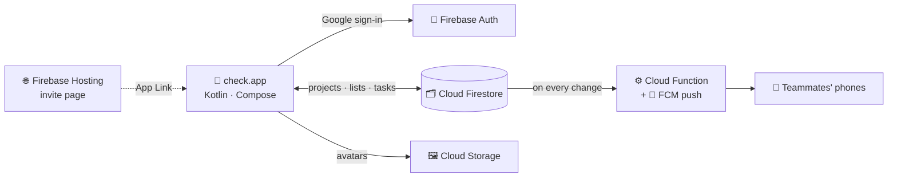

<p align="center">
  
</p>

<p align="center">
  
  
  
  
  
</p>

<p align="center">
  <b>Plan together. Tick it off. Stay in sync.</b><br>
  A task manager for Android built around <b>projects → lists → tasks</b>, with live sharing between people.
</p>

> 🚀 **In a hurry?** Create a Firebase project, drop its `google-services.json` into `app/` and run `./gradlew installDebug`. The full walkthrough is under *Getting started* below.

## ✨ Features

- 🗂️ **Three levels of order**: a project holds lists, a list holds tasks
- ☁️ **Live sync**: every change shows up on all your devices through Cloud Firestore
- 🔐 **Sign in with Google** (Credential Manager + Firebase Auth)
- 🤝 **Share a project** by e-mail, or send a link that opens it straight in the app (verified App Links on Firebase Hosting)
- 🔔 **Notifications**: push messages (FCM + Cloud Functions) and an in-app list of what changed in shared projects
- 👆 **Swipe a task away** to delete it, with undo
- 🧩 **Home-screen widget** with the tasks of one list
- 🖼️ **Your own avatar**, stored in Firebase Storage
- 🔊 **A small reward**: a sound when a task gets done
- 🎨 **Dark cobalt theme** with neon accents and a 3D-style navigation drawer
- 🛡️ **Locked down**: Firestore and Storage security rules plus Firebase App Check

## 🧭 How it fits together



The app talks to Firestore directly. A Cloud Function watches for changes and sends a push to the members of the project, except the device that made the change. The invite page on Hosting turns a shared link into an App Link that opens the project in the app.

## 🧰 Tech stack

- 📱 Kotlin, Jetpack Compose (Material 3) and a Glance app widget
- 🔥 Firebase: Auth, Firestore, Storage, Cloud Messaging, App Check and Hosting
- ⚙️ Cloud Functions on Node.js 22

## 📁 Repository layout

| Path | Contents |
| --- | --- |
| 📱 `app/` | The Android app |
| ⚙️ `functions/` | Cloud Function that sends push notifications about shared projects |
| 🌐 `web/` | Firebase Hosting site: the invite page behind share links and the App Links file |
| 🛡️ `firestore.rules`, `storage.rules`, `firebase.json` | Firebase configuration and security rules |
| 🧪 `firestore.test.js` | Firestore rules tests (they run against the Firestore emulator) |
| 📐 `firebase-blueprint.json` | Short description of the data model |
| 🖼️ `docs/` | The README banner |

## 🚀 Getting started

### 1. 🔥 Firebase project

Create a Firebase project and enable Authentication (Google sign-in), Cloud Firestore and Cloud Messaging. Choose the Firestore location first: the Cloud Function is deployed to a region next to the database (see *Making it yours* below).

Three parts are optional, and the rest of the app does not depend on them: Storage (profile pictures), Hosting (share links) and Cloud Functions (push notifications). Storage and Functions need the Blaze (pay-as-you-go) plan, which has a free tier.

Point `.firebaserc` at your project.

### 2. 🔑 `google-services.json`

Register the Android app in the Firebase console, add the SHA-1 of your signing key, download `google-services.json` and put it into `app/`. `app/google-services.json.example` shows the shape of the file. The real file is git-ignored.

The application id is `applicationId` in `app/build.gradle.kts`. You can keep it or change it; register the one you use in Firebase.

### 3. 🔏 Debug keystore

The `debug` and `optimized` builds are signed with `debug.keystore` in the project root (git-ignored). Copy the one from `~/.android/debug.keystore`, or create it:

```bash
keytool -genkeypair -keystore debug.keystore -storepass android -alias androiddebugkey -keypass android -keyalg RSA -keysize 2048 -validity 10000 -dname "CN=Android Debug,O=Android,C=US"
```

### 4. 🏗️ Build and run

```bash
./gradlew installDebug       # debug build
./gradlew installOptimized   # R8-optimised build signed with the debug key; much smoother on a real phone
```

A `release` build needs your own upload key. Set `KEYSTORE_PATH` (default: `my-upload-key.jks` in the project root), `STORE_PASSWORD` and `KEY_PASSWORD`; the key alias is `upload`.

### 5. 🛡️ App Check

Debug and optimized builds use the App Check debug provider: register the debug token that the SDK prints to Logcat in the Firebase console, or pass it in the `FIREBASE_APPCHECK_DEBUG_TOKEN` intent extra. Release builds use reCAPTCHA; put your site key into `recaptcha_site_key` in `app/src/main/res/values/firebase_config.xml`.

### 6. ☁️ Backend

```bash
cd functions
npm install
npm test
cd ..
firebase deploy              # rules, functions and hosting
```

For App Links to be verified, put the SHA-256 fingerprint of your signing certificate into `web/.well-known/assetlinks.json` before deploying hosting.

## 🛠️ Making it yours

The repository is set up for one Firebase project, so a few values are hard-coded. After forking, replace them with your own. This command lists every place that mentions the original project:

```bash
git grep -n "check-app-lists"
```

| What | Where | Needed for |
| --- | --- | --- |
| Firebase project id | `.firebaserc` | `firebase deploy` |
| Storage bucket (`<project-id>.firebasestorage.app`) | `firebase.json`, the `storage` section | Deploying the Storage rules |
| Hosting domain (`<project-id>.web.app`) | `AndroidManifest.xml` (`android:host`), `ShareLinks.kt` (`HOST`), and the `og:image` and `twitter:image` tags in `web/index.html` and `web/invite.html` | Share links |
| Signing certificate (SHA-256) | `web/.well-known/assetlinks.json` | Verifying App Links |
| Application id | `app/build.gradle.kts` (`applicationId`), `web/.well-known/assetlinks.json` (`package_name`) and `web/invite.html` (`package=` in the intent link) | Only if you change it |
| Cloud Functions region | `functions/index.js` (`OPTIONS.region`, now `us-central1`, next to a Firestore database in `nam5`) | Pick a region that suits your Firestore location |
| reCAPTCHA site key | `app/src/main/res/values/firebase_config.xml` | App Check in release builds |

Without Hosting only the share links stop working; without Functions you lose only the push notifications.

---

<p align="center">Made with Kotlin, Jetpack Compose and a lot of ✅</p>
